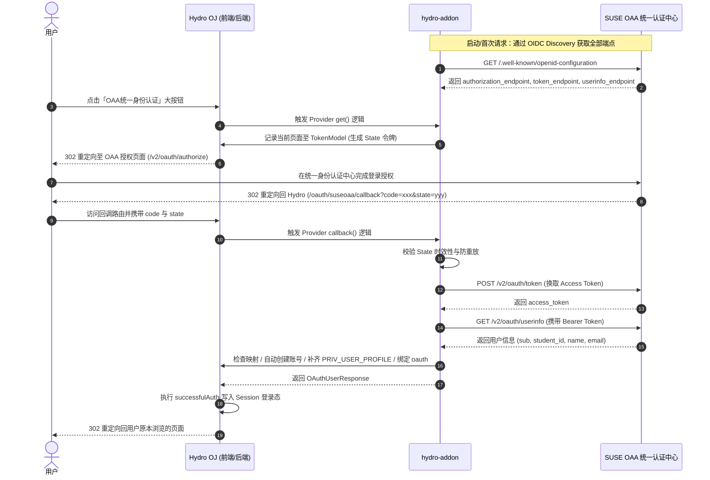

# Hydro OJ - SUSE OAA 统一身份认证原生插件 (hydro-addon)

`hydro-addon` 是为 **Hydro Online Judge (v5.x)** 深度定制的原生单点登录（SSO）插件，用于无缝对接 **SUSE OAA 统一身份认证中心**。

启用本插件后，无需依赖任何前置的外部反向代理认证网关，Hydro OJ 的登录界面（右上角登录弹窗与 `/login` 独立页面）将自动原生渲染「**OAA统一身份认证**」入口大按钮。支持静默无感自动开号、全自动登录会话种下、状态回溯跳回用户原本正在浏览的页面。

---

## 核心特性

- **完整支持标准 OIDC Discovery**：**只需配置主域名（Issuer）**，插件全自动通过 `/.well-known/openid-configuration` 动态发现并解析授权端点、令牌端点与用户信息端点，免去繁琐配置。
- **原生微内核接入**：完全基于 Hydro 的 Cordis 架构与 `oauth.provide` 标准规范开发，与 Hydro 原生登录体系完美融合。
- **一键秒进首页（免确认密码）**：用户首次授权即可自动创建系统用户并直接登录，跳过传统需要手动输入密码的二次注册确认流程。
- **关键权限自动补齐**：自动为新用户授予 `PRIV.PRIV_USER_PROFILE`（数值为 `4`），杜绝因权限缺失被系统自动降级为 `guest` 并清理 session 的暗坑。
- **多凭证唯一映射**：同时收集并绑定 `sub`、`student_id`、`email` 到 MongoDB `oauth` 映射集合中，支持精准识别与重复登录账号关联。
- **CSRF 防重放安全防护**：通过 `TokenModel.TYPE_OAUTH` 自动签发并校验 600 秒时效的加密 State 令牌，并在使用后立即销毁。
- **后台可视化动态配置**：在 Hydro 控制面板后台注入「SUSE OAA」配置组，字段类型严格使用标准 `'text'` 规范定义，避免前端模板崩溃。

---

## 交互与认证流程



---

## 服务器部署与启用指南

### 第一步：拉取插件代码至服务器

推荐将插件存放在服务器常用目录（例如 `/root/hydro-addon`）：

```bash
cd /root
git clone https://github.com/suse-edu-cn/hydro-addon.git
cd hydro-addon
```

### 第二步：在 Hydro OJ 中启用 Addon

使用 Hydro 官方命令行工具直接将本插件添加为 Addon：

```bash
# 注册插件绝对路径
hydrooj addon add /root/hydro-addon

# 查看当前已加载的插件列表（确认列表中出现 /root/hydro-addon）
hydrooj addon list
```

> **提示**：Hydro 会将插件自动记录到 `~/.hydro/addon.json` 中。

### 第三步：重启 Hydro 服务

根据你的部署方式重启 Hydro 服务进程：

**使用 PM2 管理（主流）：**
```bash
pm2 restart hydrooj

# 观察服务启动日志，确认插件成功挂载：
pm2 logs hydrooj --lines 40
```

**使用 Systemd 管理：**
```bash
systemctl restart hydrooj

# 查看日志确认启动状态：
journalctl -u hydrooj -f -n 40
```

---

## Nginx 切换回原生直连配置

之前若使用了外部反向代理认证网关（如 forward-auth / oauth2-proxy / 前置拦截脚本），会导致所有用户请求在到达 Hydro OJ 之前被前置拦截。

现在由本插件在内部原生接管 OAuth 回调，**请将 Nginx 恢复为纯粹的高性能反向代理**：

编辑 Nginx 站点配置文件（通常位于 `/etc/nginx/sites-available/` 或 `/etc/nginx/conf.d/`）：

```nginx
server {
    listen 80;
    server_name oj.suse.edu.cn; # 替换为你 Hydro OJ 的实际域名
    return 301 https://$host$request_uri;
}

server {
    listen 443 ssl http2;
    server_name oj.suse.edu.cn; # 替换为你 Hydro OJ 的实际域名

    # SSL 证书配置
    ssl_certificate /etc/nginx/ssl/oj.suse.edu.cn.crt;
    ssl_certificate_key /etc/nginx/ssl/oj.suse.edu.cn.key;
    ssl_protocols TLSv1.2 TLSv1.3;
    ssl_ciphers HIGH:!aNULL:!MD5;

    # 客户端上传限制（题目测试数据包 / 头像等）
    client_max_body_size 128m;

    location / {
        # 原生直连本地 Hydro 运行端口（默认为 8888）
        proxy_pass http://127.0.0.1:8888;
        proxy_http_version 1.1;

        # WebSocket 协议支持（评测状态实时推送、终端交互）
        proxy_set_header Upgrade $http_upgrade;
        proxy_set_header Connection "upgrade";

        # 客户端真实网络信息传递
        proxy_set_header Host $http_host;
        proxy_set_header X-Real-IP $remote_addr;
        proxy_set_header X-Forwarded-For $proxy_add_x_forwarded_for;
        proxy_set_header X-Forwarded-Proto $scheme;

        # 缓冲区与超时参数优化
        proxy_connect_timeout 60s;
        proxy_send_timeout 120s;
        proxy_read_timeout 120s;
        proxy_buffering off;
    }
}
```

测试并重载 Nginx：
```bash
nginx -t && nginx -s reload
```

---

## 系统配置与注意事项

### 1. 确保 Hydro 的 `server.url` 正确
登录管理员账号，进入 **控制面板 (Control Panel)** -> **系统设置** -> 搜索 `server.url`：
- 务必设置为包含协议与末尾斜杠的公网实际地址，例如：`https://oj.suse.edu.cn/`。
- 回调地址 `redirect_uri` 将基于该配置生成：`https://oj.suse.edu.cn/oauth/suseoaa/callback`。

### 2. 插件后台配置项说明
进入 **控制面板** -> **SUSE OAA** 配置分组，**日常只需关注前三项即可**：

| 配置键名 | 默认值 | 类型 | 说明 |
| :--- | :--- | :--- | :--- |
| `suseoaa.issuer` | `https://v2-api.suseoaa.com` | text | **统一认证主域名 (Issuer)**，填入主域名后自动进行 OIDC 发现 |
| `suseoaa.client_id` | `suse_oj` | text | SUSE OAA OAuth2 客户端标识 |
| `suseoaa.client_secret` | `oaa_sec_...` | text (秘文) | SUSE OAA OAuth2 客户端密钥 |
| `suseoaa.scope` | `openid profile email` | text | 申请的 OAuth 作用域 |
| `suseoaa.auto_register` | `true` | text | 是否开启免确认静默自动开号 |
| `suseoaa.authorize_url` | *(留空)* | text | 【高级选填】覆盖自动发现的授权端点（留空即可） |
| `suseoaa.token_url` | *(留空)* | text | 【高级选填】覆盖自动发现的令牌端点（留空即可） |
| `suseoaa.userinfo_url` | *(留空)* | text | 【高级选填】覆盖自动发现的用户信息端点（留空即可） |

---

## 许可证
[MIT License](LICENSE)
